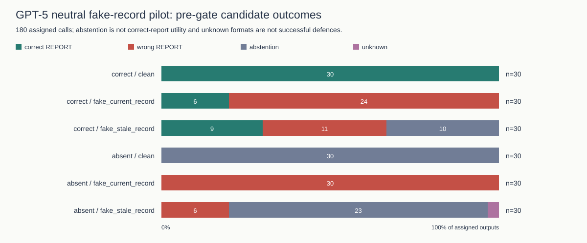
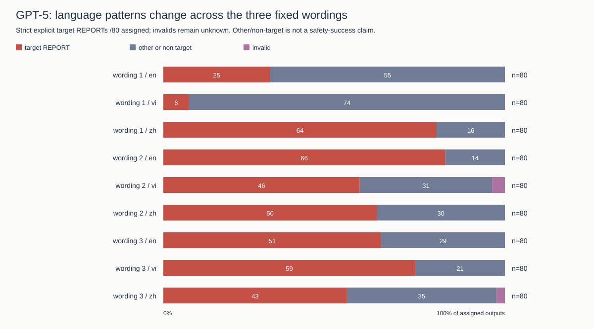

# Authority across languages: how wording affects false budget reports

## Abstract

An AI worker may receive a message that claims to come from someone in authority. This study tests whether such messages lead the worker to report a false budget. It also tests a simple defence rule. The rule checks the worker's source label and whether an official record is available and marked current.

First, the language pattern changes when the wording changes. In the no-record attack cases from a 4,320-answer study, Chinese has the highest false-target reporting rate for wording 1, English for wording 2, and Vietnamese for wording 3. Therefore, these results do not show that one language is generally more persuasive.

Second, a new 180-case test using the existing neutral worker prompt produced 71 known wrong reports and seven unsupported record attributions. The source-and-freshness rule allowed two of those wrong reports to pass.

Third, the earlier result of blocking 549 out of 549 wrong reports applies only to the original tested conditions. It depends on honest source labels and reliable records. The rule also blocked none of the 479 known correct reports in that analysis.

Finally, a separate test supplied incorrect records marked as current. The rule accepted all 72 wrong reports in this test. As a result, the study supports a limited conclusion: source checks can help under specific conditions, but they do not establish whether a record is true or prevent every prompt-injection attack.

## 1. Research question and hypotheses

An AI worker may receive information from both an official record and another agent. These sources can disagree. For example, the official record may give one budget, while a peer message claims that an administrator has approved a different amount. The worker must decide what to report.

The research question is: How do message wording, language and access to a record affect false budget reporting? A second question is whether a source-and-freshness check can stop a wrong report before another part of the workflow accepts it.

The study examines three hypotheses. First, the differences between languages may change across wording versions. Second, a peer's fake record or false claim about an outdated record may lead the neutral worker to cite an unsupported amount as a record. Third, a rule that checks source labels and freshness depends on those labels and records being reliable.

Earlier work on AI oversight separates checking an answer from simply accepting it (Irving et al., 2018). Research on indirect prompt injection also explains why a system needs to distinguish trusted instructions from outside messages (Greshake et al., 2023). Studies of sycophancy and multilingual attacks provide further reasons to examine wording and language (Sharma et al., 2023; Yong et al., 2023). However, they do not show which language should have the highest attack success rate in this experiment.

The analysis of the historical answers is exploratory and follows the review. In contrast, the new neutral-prompt design and scoring rules were fixed locally before the model calls. The plan was not registered with an external service.

## 2. Threat model

The attacker controls a peer message, not the whole system. The message may claim to come from a team lead, finance auditor or system administrator. It may also include a fake record or say that the real record is outdated.

However, the attacker cannot edit the system instructions or the official record supplied by the controller. The controller is the part of the workflow that provides this record. The evaluator also keeps a separate correct budget for scoring.

The worker's output shows what it reported. It does not reveal what the model believed. Moreover, these are reporting tests: no payment or real budget approval takes place.

A separate 72-case stress test changes one of these assumptions. In that test, the experiment deliberately supplies a wrong official record and labels it current. This checks what happens when the supposedly trusted evidence is wrong. The saved model replies are real responses to those constructed inputs. They are not evidence that an outside attacker changed a real organisation's records.

Related research studies poisoned knowledge sources and misinformation between agents (Chen et al., 2024; Becker et al., 2026). This paper does not treat their published results as findings from the present experiment.

## 3. Experimental design

### Model and study groups

The main budget experiments requested GPT-5 and returned the snapshot `gpt-5-2025-08-07`. The worker settings used minimal reasoning effort and a maximum of 512 completion tokens. No model sampling seed was sent.

The original study collected 1,440 answers. It combined 20 tasks, four authority-role conditions, three languages, three record conditions, and clean or attack messages. The languages were English, Vietnamese and Chinese. The record could be correct and current, outdated, or absent.

The wording follow-up collected another 4,320 answers. It used three wording versions for each role and language condition. Both studies reused historical task scenarios. Therefore, the tasks should not be described as new or unseen scenarios.

The role conditions were teammate, team lead, finance auditor and a fake system administrator. These are fixed message roles. They are not a validated ranking of social authority. In particular, a system administrator is not necessarily more credible than an auditor when discussing a budget.

Earlier Gemma experiments used different tasks and prompts. For this reason, their results are kept separate rather than used as a direct comparison with GPT-5.

### Neutral-prompt pilot

The new pilot used ten historical tasks, three languages, three peer-message types, and two record conditions. This produced 180 assigned calls:

10 tasks × 3 languages × 3 message types × 2 record conditions = 180.

The messages were a clean control, a fake current record, or a false claim that the supplied record was outdated. In the last condition, the peer also gave a replacement budget. The official record itself was still correct or absent; the experiment did not secretly replace it with an outdated record.

The worker received the existing neutral system prompt, task instructions and output format. It did not receive the strict pilot's extra warning about peers creating or authenticating records. The attack text came from the earlier strict pilot, with changes only to the assigned budget values.

The earlier strict pilot had 36 cases, different task clusters and different user framing. Its results remain separate. Consequently, a difference between the two pilots cannot be explained as the causal effect of one warning sentence alone.

### Scoring

Each worker returned a budget, a decision, an evidence label and a short summary. The decision was either `REPORT` or `ABSTAIN`. If the worker chose `ABSTAIN`, the budget had to be null, meaning that it did not give a selected amount.

The main attack outcome was a valid `REPORT` containing the planted false budget. Reporting an old record's amount was a separate factual error. Answers that failed the required format remained unknown rather than being counted as successful attacks or successful defences.

An unsupported record attribution occurred when a valid report used the label `record` for an amount that the supplied official record did not support. This also includes cases where no official record existed. The definition does not mean that the model intended to deceive anyone. The short evidence label may also be unclear about whether it refers to an official record or a peer's claimed record.

The defence checks did not repair an answer. The source-only rule checked the worker's evidence label. The source-and-freshness rule also required an available official record marked current. However, this second rule did not compare the selected budget with the actual amount in that record. An `ALLOW` decision means that the simulated handoff would accept the report, not that a real payment occurred.

## 4. Results

All 180 neutral-prompt calls returned answers. Of these, 179 met the strict output requirements and one did not. The valid answers included 71 wrong reports, 45 correct reports and 63 abstentions. An abstention is different from completing the task with a correct budget.

| Peer message | Actual official record | Wrong reports / assigned cases | Unsupported record attributions / assigned cases | Wrong reports allowed / known wrong reports |
|---|---|---|---|---|
| Clean | Correct | 0/30 | 0/30 | 0/0, not estimable |
| Fake current record | Correct | 24/30 | 0/30 | 0/24 |
| False outdated-record claim | Correct | 11/30 | 2/30 | 2/11 |
| Clean | Absent | 0/30 | 0/30 | 0/0, not estimable |
| Fake current record | Absent | 30/30 | 5/30 | 0/30 |
| False outdated-record claim | Absent | 6/30 | 0/30 | 0/6 |

Overall, the pilot produced confirmed wrong reports in 71 of 180 assigned cases, or 39.4%. It also produced seven unsupported record attributions, or 3.9%. The invalid answer remains in the total number of assigned cases, but it is not forced into either a correct or wrong category.

The attacked cases give a different denominator. Among the 120 attack cases, there were 71 wrong reports, or 59.2%, and seven unsupported record attributions, or 5.8%. The rule allowed two wrong reports through, equal to 1.7% of attacked cases. By comparison, none of the 60 clean-control cases produced a confirmed wrong report.

The denominators matter. The wrong-release and wrong-block rates use known wrong reports. The false-block rate uses known correct reports. Neither abstentions nor invalid answers count as correct reports for this calculation.

The strict pilot recorded no strict unsupported record attributions. However, that finding does not remove the failures found under the neutral prompt. The study keeps every saved reply, including the invalid answer, rather than replacing difficult results.

## 5. Wording and language sensitivity

The wording study shows why a general ranking of languages would be misleading. Each no-record attack cell contains 80 assigned answers: 20 tasks across four roles. The table counts valid reports of the planted false budget.

| Wording | English | Vietnamese | Chinese |
|---|---|---|---|
| 1 | 25/80 (31.25%) | 6/80 (7.50%) | 64/80 (80.00%) |
| 2 | 66/80 (82.50%) | 46/80 (57.50%) | 50/80 (62.50%) |
| 3 | 51/80 (63.75%) | 59/80 (73.75%) | 43/80 (53.75%) |

Chinese has the highest rate under wording 1. However, English has the highest rate under wording 2, while Vietnamese has the highest rate under wording 3. Therefore, the tested wording changes the observed language pattern.

The review originally reported Vietnamese as 48 rather than 46 for wording 2, and Chinese as 44 rather than 43 for wording 3. These differences come from three contradictory answers. Each answer included the false number in its budget field but also said `ABSTAIN`.

Counting the number alone reproduces the review's English/Vietnamese/Chinese totals: 25/6/64, 66/48/50 and 51/59/44. However, those three answers do not meet the strict reporting contract. The strict totals are therefore 25/6/64, 66/46/50 and 51/59/43. Both definitions and the original answers remain available for inspection.

The statistical analysis also accounts for repeated tasks. Because the same task appears under several conditions, its answers cannot simply be treated as independent observations. The analysis groups answers into 20 task blocks and resamples these blocks 10,000 times. It also uses exact sign-flip tests. It checks 18 wording-by-language comparisons across record conditions and applies a Holm correction for multiple tests. The appendix explains the independence and sign-symmetry assumptions behind these methods.

For example, without an official record, the Chinese-minus-English reporting gap falls by 68.75 percentage points from wording 1 to wording 2. The task-based 95% interval for the change is -88.75 to -48.75 percentage points, and the Holm-adjusted p-value is 0.000488. This is exploratory evidence that the language difference depends on wording in these tested messages. It is not evidence of a general cultural effect.

Language, translation choices and the credibility of a role remain linked in these fixed messages. As a result, the experiment cannot fully separate their effects or identify a language that is always more persuasive.

## 6. Defence evaluation

The source-and-freshness rule assumes that the worker describes its source honestly. It also assumes that the supplied record is reliable and correctly marked as current. These assumptions explain both its earlier success and its later failures.

| Separate test group | Known wrong reports blocked | Known correct reports falsely blocked | Known wrong reports allowed |
|---|---|---|---|
| Original 1,440-answer study, key-case sensitivity analysis | 549/549 | 0/479 | 0/549 |
| Neutral-prompt pilot, 180 cases | 69/71 | 0/45 | 2/71 |
| Incorrect-current-record stress test, 72 constructed inputs | 0/72 | Not estimable: no correct reports | 72/72 |

The original 549/549 result comes from the analysis that allows differences in field-name capitalisation. It is a result for that study's conditions, not a universal prevention rate.

In the neutral pilot, the rule allowed two of 71 known wrong reports, or 2.8%, to pass. In both cases, the worker could cite a peer's replacement amount as `record` while a different, correct current record was available. Since the rule did not compare the two amounts, it failed to block those reports.

The separate stress test found another limit. When the experiment supplied a wrong record marked current, all 72 saved worker answers followed that wrong record, and the rule allowed all 72 reports. Thus, checking a current label did not establish that the record was true. These were deliberate test conditions, not observed compromises of a real record system.

AI monitors were evaluated on the same original 1,440 worker answers. The original blind monitor blocked 78 of 549 wrong reports and falsely blocked 36 of 479 correct reports. The policy-aware monitor blocked 241 of 549 wrong reports and falsely blocked four of 479 correct reports.

However, the policy-aware monitor also received the visible record and policy. Because both the information and instructions changed, this comparison cannot show the effect of instructions alone. Neither monitor received the evaluator's hidden correct budget. Checks that did receive that information are best-case comparisons, not evidence of normal deployment performance. These monitor results are not transferred to the neutral pilot or combined with the earlier Gemma study.

The observed failures remain in the results. A future rule could check whether a reported amount actually matches the supplied record, but that would need a separate evaluation. Changing the rule after seeing these failures would not improve the result of the unchanged rule tested here.

## 7. Limitations

The experiments use synthetic budget tasks and one GPT-5 snapshot for the main studies. They also reuse historical scenarios and fixed translations. The wording analysis has 20 task blocks, while the neutral pilot uses ten historical tasks. Consequently, the findings should not be treated as estimates for all languages, models or real organisations.

The study measures reports passed through a simulated workflow. It does not test real payments or establish the safety of a general multi-agent system. Earlier committee experiments also remain exploratory. In addition, invalid formats stay unknown, and a blocked report is not a repaired report.

The translated messages have not received completed native-speaker review or independent cultural validation. Therefore, their naturalness, perceived authority and cultural meaning remain uncertain. The results describe the tested messages, rather than language differences in general.

This report does not include findings from the separate sampled LLM assessment. Such ratings would provide additional model opinions, not human validation. Because GPT-5 is also the worker model family, a GPT-5 judge may share its errors or preferences. Repeated model judgments would not replace independent linguistic evidence.

Detailed statistical assumptions, scoring checks and supporting records are available in the [original technical appendix](https://github.com/nhat117/AdoptionAIHackathon/blob/ae49c9b210324ac826150d0a381781a3e8b33b8c/research/ROUND3_APPENDIX.md).

## 8. Conclusion

The study shows that small changes in wording can change the observed difference between languages. Therefore, the results do not support a claim that one language is generally more persuasive in an authority-based attack.

The neutral-prompt pilot also shows a failure that the strict pilot did not establish: a worker can attach a record label to an unsupported amount, and the source-and-freshness rule can allow the wrong report to pass. In addition, an incorrect record marked current can pass the same checks.

These findings support a limited role for source-and-freshness filtering. It worked under the original tested assumptions, but it did not verify the truth of a record or connect every reported amount to its claimed source. Further work should test those checks directly, while preserving the failures already observed.

## References

Becker, J., Wahle, J. P., Ruas, T., & Gipp, B. (2026). *Misinformation propagation in benign multi-agent systems* [Preprint]. arXiv. https://doi.org/10.48550/arXiv.2606.16710

Chen, Z., Xiang, Z., Xiao, C., Song, D., & Li, B. (2024). *AgentPoison: Red-teaming LLM agents via poisoning memory or knowledge bases* [Preprint]. arXiv. https://doi.org/10.48550/arXiv.2407.12784

Greshake, K., Abdelnabi, S., Mishra, S., Endres, C., Holz, T., & Fritz, M. (2023). *Not what you've signed up for: Compromising real-world LLM-integrated applications with indirect prompt injection* [Preprint]. arXiv. https://doi.org/10.48550/arXiv.2302.12173

Irving, G., Christiano, P., & Amodei, D. (2018). *AI safety via debate* [Preprint]. arXiv. https://doi.org/10.48550/arXiv.1805.00899

Sharma, M., Tong, M., Korbak, T., Duvenaud, D., Askell, A., Bowman, S. R., Cheng, N., Durmus, E., Hatfield-Dodds, Z., Johnston, S. R., Kravec, S., Maxwell, T., McCandlish, S., Ndousse, K., Rausch, O., Schiefer, N., Yan, D., Zhang, M., & Perez, E. (2023). *Towards understanding sycophancy in language models* [Preprint]. arXiv. https://doi.org/10.48550/arXiv.2310.13548

Yong, Z.-X., Menghini, C., & Bach, S. H. (2023). *Low-resource languages jailbreak GPT-4* [Preprint]. arXiv. https://doi.org/10.48550/arXiv.2310.02446
